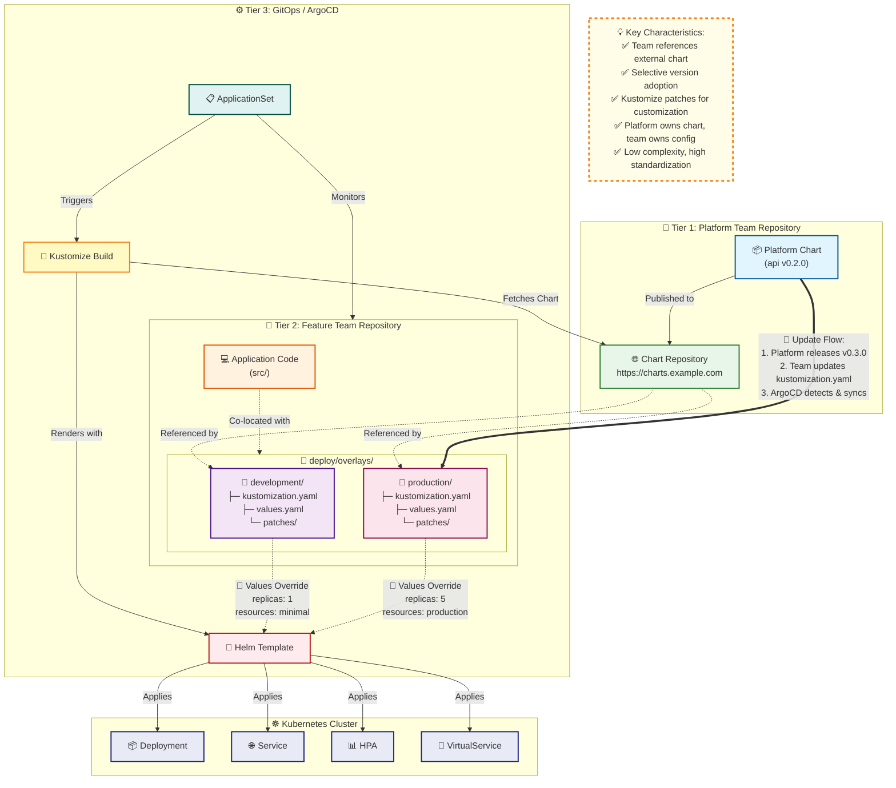

# Chapter 3: Three-Tier Architecture Overview

### 3.1 Architecture Overview

The three-tier architecture provides clear boundaries between platform responsibilities, team ownership, and orchestration logic. Each tier serves a distinct purpose, owned by specific teams, with well-defined interfaces between tiers. This separation enables independent evolution while maintaining system coherence.

Tier 1 represents the Platform Chart Repository where centralized Helm chart templates live. Tier 2 encompasses Feature Team Service Repositories where feature teams own both application code and deployment configuration. Tier 3 comprises the GitOps Repository containing ArgoCD application definitions. Understanding how these tiers interact and the responsibilities of each is essential to implementing and operating the architecture successfully.



### 3.2 Tier 1: Platform Chart Repository

#### Purpose and Ownership

The Platform Chart Repository serves as the authoritative source for deployment templates. Platform teams maintain these charts, encoding organizational best practices and production-ready configurations. The repository provides versioned templates that feature teams consume, following semantic versioning principles to communicate compatibility and changes.

#### Repository Structure

The platform chart repository, hosted at a location such as `sf-helm-registry`, contains multiple charts for different service types. An API chart provides templates for RESTful microservices with HTTP endpoints. A worker chart supports background job processors and event consumers. Each chart follows standard Helm structure with `Chart.yaml` for metadata and versioning, a templates directory containing Kubernetes manifest templates, `values.yaml` providing default configuration, and `values.schema.json` enabling validation.

```
sf-helm-registry/
├── charts/
│   ├── api/                        # API service chart
│   │   ├── Chart.yaml              # version: 0.2.0
│   │   ├── README.md
│   │   ├── templates/
│   │   │   ├── deployment.yaml
│   │   │   ├── service.yaml
│   │   │   ├── hpa.yaml
│   │   │   ├── virtualservice.yaml
│   │   │   ├── serviceaccount.yaml
│   │   │   └── _helpers.tpl
│   │   ├── values.yaml             # Production-ready defaults
│   │   └── values.schema.json      # Validation schema
│   └── worker/                     # Worker service chart
│       ├── Chart.yaml
│       ├── templates/
│       └── values.yaml
└── README.md
```

#### Chart Features

Platform charts encode production-ready patterns. Deployment templates include affinity rules for distributing pods across failure domains, ensuring high availability. Horizontal Pod Autoscaler configurations provide scaling based on CPU and memory metrics. Service mesh integration through Istio VirtualService and DestinationRule resources enables traffic management and observability. ServiceAccount definitions support workload identity and least privilege access. Standardized labels and annotations ensure consistency across the platform for monitoring, logging, and operational tooling.

#### Versioning and Release Management

Platform teams follow semantic versioning for chart releases. Major versions indicate breaking changes that require manual intervention during adoption. Minor versions introduce new features while maintaining backward compatibility. Patch versions contain bug fixes and minor improvements with no interface changes. Each release receives a Git tag matching the version, and teams reference specific versions in their deployment configurations. This versioning enables selective adoption, where teams upgrade when ready rather than being forced to take updates immediately.

### 3.3 Tier 2: Feature Team Service Repositories

#### Purpose and Ownership

Feature Team Service repositories represent complete ownership boundaries for feature teams. Each repository contains both application source code and deployment configuration. This co-location ensures that code changes and their corresponding deployment requirements exist in the same pull request, maintaining atomic commits and simplifying rollback procedures.

#### Repository Structure

A Feature Team Service repository like `aggregator-service` contains several key directories. The `src` directory holds application source code, such as TypeScript for a Node.js service. The `deploy` directory contains all deployment configuration, structured to support the Helm plus Kustomize hybrid approach. Within deploy, the `charts` directory holds a local Helm chart instance when teams choose to embed the chart. The `environments` directory contains metadata files for ArgoCD ApplicationSet generators. The `overlays` directory structures environment-specific configurations with subdirectories for each environment like development, staging, and production.

```
aggregator-service/
├── src/
│   └── index.ts                    # Application code
├── deploy/
│   ├── charts/
│   │   └── aggregator/             # Local chart (optional)
│   ├── environments/
│   │   ├── development.yaml        # env: dev, namespace: super-fortnight-dev
│   │   ├── staging.yaml
│   │   └── production.yaml
│   └── overlays/
│       ├── development/
│       │   ├── kustomization.yaml  # References chart v0.2.4
│       │   ├── values.yaml         # Dev-specific values (~30 lines)
│       │   └── patches/
│       │       ├── configmap.yaml
│       │       └── deployment.yaml
│       ├── staging/
│       └── production/
│           ├── kustomization.yaml  # References chart v0.2.3
│           ├── values.yaml
│           └── patches/
│               ├── deployment-affinity.yaml
│               ├── hpa-scaling.yaml
│               └── production-resources.yaml
├── Dockerfile
├── package.json
└── README.md
```

#### Environment Overlays

Each environment overlay directory contains a `kustomization.yaml` file that references the platform chart and specifies the version to use. A `values.yaml` file provides environment-specific Helm values that override chart defaults. A patches directory holds Kustomize patches for targeted transformations that values alone cannot express. This structure enables teams to maintain minimal configuration, typically around 30 lines of values, while leveraging the extensive templates from platform charts.

#### Chart Version Control

Teams control which platform chart version their service uses through the helmCharts section in each environment's `kustomization.yaml` file. Development might reference version 0.2.4 to test new features, while production remains on proven version 0.2.3. When teams validate a new chart version in development and staging, they update production's chart reference independently. This granular control enables safe, gradual rollout of platform improvements.

### 3.4 Tier 3: GitOps Repository

#### Purpose and Ownership

The GitOps repository serves as the orchestration layer, containing ArgoCD application definitions that declare which services should be deployed and where they should run. Platform teams maintain this repository, adding application definitions when new services join the platform and configuring deployment policies. This repository changes infrequently, primarily when onboarding new services or modifying platform-wide deployment policies.

#### ApplicationSet Pattern

Rather than maintaining separate ArgoCD Application resources for each service and environment combination, the architecture uses ApplicationSet resources with Git generators. An ApplicationSet iterates over environment files in team repositories, creating Application instances dynamically. This pattern reduces duplication in the GitOps repository and enables teams to add new environments without platform team intervention. The team simply adds a new environment file to their repository, and ArgoCD creates the corresponding application automatically.

#### Repository Structure

The GitOps repository contains a services directory with one ApplicationSet file per service. Each ApplicationSet configures a Git generator pointing to the team repository's environments directory, defines a template for creating Applications, specifies source configuration pointing to the team repository's overlay path, sets destination cluster and namespace, and configures sync policies for automated deployment. This minimal structure in the GitOps repository maintains simplicity while enabling sophisticated deployment orchestration.

```
gitops-v2/
└── services/
    ├── aggregator-appset.yaml      # ApplicationSet for aggregator
    ├── paper-appset.yaml
    ├── rock-appset.yaml
    ├── scissor-appset.yaml
    └── README.md
```

### 3.5 Tier Interactions

#### Configuration Flow

Understanding how configuration flows through the three tiers clarifies the architecture's operation. When a team commits changes to their service repository, ArgoCD detects the change through GitOps repository monitoring. ArgoCD reads the ApplicationSet and identifies which applications to sync. For each application, ArgoCD fetches the team repository at the specified overlay path. Kustomize renders the configuration, fetching the Helm chart from Tier 1, rendering templates with values from Tier 2, applying patches from the overlay, and producing final Kubernetes manifests. ArgoCD applies the manifests to the cluster, creating or updating resources. This flow ensures that the cluster state reflects the desired state declared in Git across all three tiers.

#### Separation of Concerns

The three-tier structure enforces clean separation of concerns. Platform teams in Tier 1 define what a well-configured deployment looks like, encoding best practices and organizational standards. Feature teams in Tier 2 specify how their specific service deviates from defaults, providing service-specific values and environment-specific patches. Platform teams in Tier 3 orchestrate which services deploy and where, managing the mapping from Git to cluster state. This separation enables independent evolution. Platform teams can release new chart versions without forcing adoption. Feature teams can deploy service changes without platform team involvement. Platform teams can modify orchestration policies without touching service configurations.

### 3.6 Benefits of Three-Tier Separation

This architectural separation delivers concrete operational benefits. Clear ownership boundaries eliminate confusion about who maintains which configuration. Change frequency differences are respected, with Tier 1 changing monthly, Tier 2 changing daily, and Tier 3 changing quarterly. Team autonomy is preserved through independent repositories and selective version adoption. Platform evolution proceeds safely through versioned interfaces and gradual rollout. The architecture scales naturally as new services join the platform, following established patterns without creating new bottlenecks or coordination requirements.
