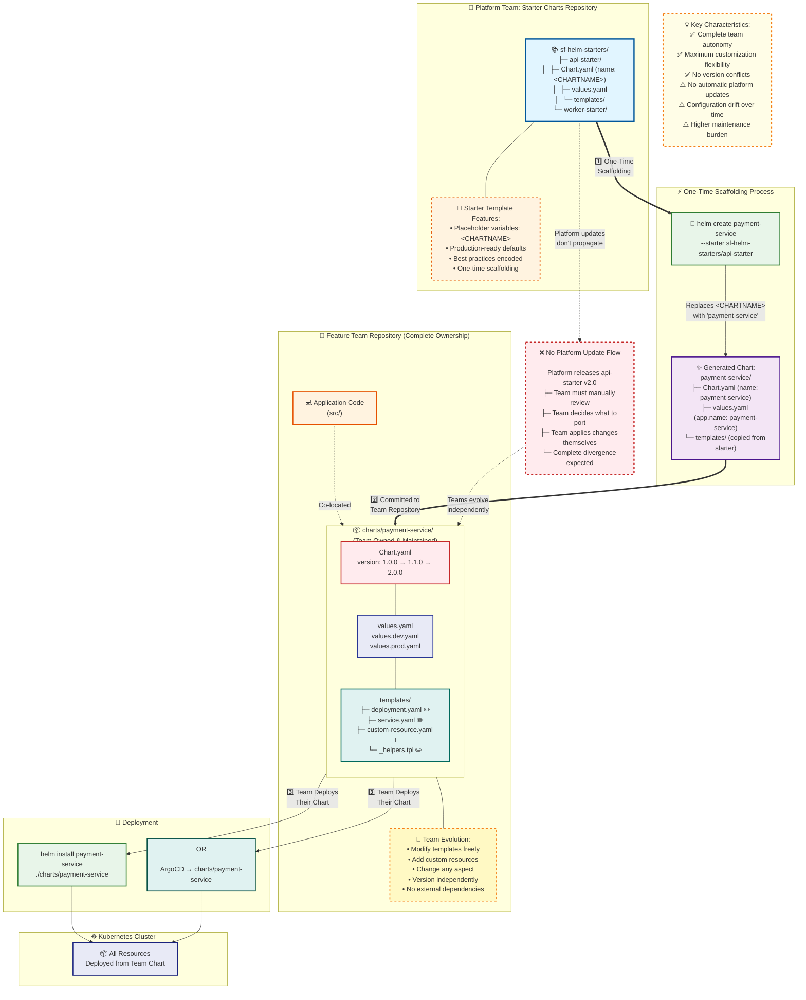

# Chapter 8: Helm Chart Ownership Models

## 9.1 Introduction to Chart Ownership Patterns

The primary architecture documented in Chapters 1-8 follows a **reference pattern** where feature teams reference platform charts through Kustomize's `helmCharts` mechanism. This chapter explores two alternative patterns that shift chart ownership dynamics and align more closely with Domain-Driven Design principles.

### Pattern Comparison Overview

| Pattern                 | Chart Ownership                | Platform Updates                  | Complexity | DDD Alignment      |
| ----------------------- | ------------------------------ | --------------------------------- | ---------- | ------------------ |
| **Reference (Current)** | Platform owns, teams reference | Automatic via version selection   | Low        | Bounded Context    |
| **Starter**             | Teams fork and own             | Manual, teams control completely  | Medium     | Autonomous Context |
| **Dependencies**        | Shared ownership, composition  | Automatic via dependency versions | High       | Aggregate Pattern  |

## 9.2 The Starter Chart Pattern

### Concept

The starter chart pattern treats platform charts as **scaffolding templates** rather than living dependencies. Teams use `helm create --starter` to generate their own service chart based on the platform template, then maintain that chart independently.

**Philosophy:** "Start together, evolve independently."

### How It Works



#### Step 1: Platform Team Creates Starter Chart

The platform team maintains starter charts in a specific directory structure:

```
sf-helm-starters/
├── api-starter/
│   ├── Chart.yaml
│   ├── values.yaml
│   └── templates/
│       ├── deployment.yaml
│       ├── service.yaml
│       ├── hpa.yaml
│       ├── virtualservice.yaml
│       └── _helpers.tpl
└── worker-starter/
    ├── Chart.yaml
    ├── values.yaml
    └── templates/
```

**Key Difference from Regular Charts:** Starter charts use template variables that Helm replaces during scaffolding:

```yaml
# api-starter/Chart.yaml
apiVersion: v2
name: <CHARTNAME>
description: A Helm chart for <CHARTNAME> service
type: application
version: 0.1.0
appVersion: "1.0"
```

```yaml
# api-starter/values.yaml
app:
  name: <CHARTNAME>
  component: api
  partOf: superfortnight

image:
  repository: <CHARTNAME>
  tag: "latest"
  pullPolicy: IfNotPresent

replicas: 1

resources:
  requests:
    memory: "256Mi"
    cpu: "100m"
  limits:
    memory: "512Mi"
    cpu: "200m"
```

#### Step 2: Feature Team Scaffolds Their Service

```bash
# Clone or access starter charts
git clone https://github.com/platform-team/sf-helm-starters.git

# Create new service chart from starter
helm create aggregator-service --starter sf-helm-starters/api-starter

# Result: aggregator-service/ directory with scaffolded chart
cd aggregator-service
ls
# Chart.yaml  values.yaml  templates/
```

The `<CHARTNAME>` placeholders are automatically replaced:

```yaml
# aggregator-service/Chart.yaml (after scaffolding)
apiVersion: v2
name: aggregator-service
description: A Helm chart for aggregator-service service
type: application
version: 0.1.0
appVersion: "1.0"
```

#### Step 3: Feature Team Repository Structure

```
aggregator-service/
├── src/
│   └── index.ts
├── charts/
│   └── aggregator-service/          # Team-owned chart
│       ├── Chart.yaml
│       ├── values.yaml
│       ├── values.dev.yaml
│       ├── values.staging.yaml
│       ├── values.prod.yaml
│       └── templates/
│           ├── deployment.yaml
│           ├── service.yaml
│           ├── hpa.yaml
│           └── virtualservice.yaml
├── Dockerfile
└── README.md
```

#### Step 4: Team Evolution

Teams now maintain their chart completely:

```bash
# Team adds custom resources
cat > charts/aggregator-service/templates/configmap.yaml <<EOF
apiVersion: v1
kind: ConfigMap
metadata:
  name: {{ include "aggregator-service.fullname" . }}-config
data:
  custom-config: "value"
EOF

# Team modifies deployment for service-specific needs
vim charts/aggregator-service/templates/deployment.yaml
# Add custom volumes, init containers, etc.

# Team releases their own versions
vim charts/aggregator-service/Chart.yaml
# version: 0.1.0 → 0.2.0

git add charts/
git commit -m "v0.2.0: Add custom configuration"
git tag chart-v0.2.0
git push --tags
```

### Advantages

1. **Complete Autonomy**: Teams control every aspect of their chart
2. **No Version Conflicts**: Teams never blocked by platform chart issues
3. **Maximum Flexibility**: Can deviate entirely from platform patterns when needed
4. **Simplified Dependencies**: No external chart dependencies to manage
5. **Clear Ownership**: Chart lifecycle completely owned by team

### Disadvantages

1. **No Platform Update Flow**: Teams must manually port improvements from platform
2. **Configuration Drift**: Each team's chart diverges over time
3. **Maintenance Burden**: Teams maintain all chart logic themselves
4. **Lost Standardization**: Platform patterns not enforced after scaffolding
5. **Duplication**: Bug fixes must be applied to each team's chart separately

### When to Use

- **Mature teams** with strong Helm expertise
- **Unique services** requiring significant customization
- **Stable requirements** where platform updates aren't critical
- **Autonomous organizations** prioritizing independence over standardization

### Proof of Concept Example

**Complete working example:**

```bash
# Platform team setup
mkdir -p sf-helm-starters/api-starter/templates
cd sf-helm-starters/api-starter

# Create starter Chart.yaml
cat > Chart.yaml <<'EOF'
apiVersion: v2
name: <CHARTNAME>
description: A Helm chart for <CHARTNAME> service
type: application
version: 0.1.0
appVersion: "1.0"
maintainers:
  - name: Platform Team
    email: platform@example.com
EOF

# Create starter values.yaml with placeholders
cat > values.yaml <<'EOF'
app:
  name: <CHARTNAME>
  component: api
  partOf: superfortnight

image:
  repository: <CHARTNAME>
  tag: "latest"
  pullPolicy: IfNotPresent

replicas: 1

service:
  type: ClusterIP
  port: 80
  targetPort: 8080

resources:
  requests:
    memory: "256Mi"
    cpu: "100m"
  limits:
    memory: "512Mi"
    cpu: "200m"

autoscaling:
  enabled: false
  minReplicas: 2
  maxReplicas: 10
  targetCPUUtilizationPercentage: 80
EOF

# Create deployment template
cat > templates/deployment.yaml <<'EOF'
apiVersion: apps/v1
kind: Deployment
metadata:
  name: {{ include "<CHARTNAME>.fullname" . }}
  labels:
    {{- include "<CHARTNAME>.labels" . | nindent 4 }}
spec:
  replicas: {{ .Values.replicas }}
  selector:
    matchLabels:
      {{- include "<CHARTNAME>.selectorLabels" . | nindent 6 }}
  template:
    metadata:
      labels:
        {{- include "<CHARTNAME>.selectorLabels" . | nindent 8 }}
    spec:
      containers:
      - name: {{ .Chart.Name }}
        image: "{{ .Values.image.repository }}:{{ .Values.image.tag }}"
        imagePullPolicy: {{ .Values.image.pullPolicy }}
        ports:
        - name: http
          containerPort: {{ .Values.service.targetPort }}
          protocol: TCP
        resources:
          {{- toYaml .Values.resources | nindent 10 }}
EOF

# Create helpers
cat > templates/_helpers.tpl <<'EOF'
{{- define "<CHARTNAME>.fullname" -}}
{{ .Values.app.name }}
{{- end }}

{{- define "<CHARTNAME>.labels" -}}
app.kubernetes.io/name: {{ .Values.app.name }}
app.kubernetes.io/instance: {{ .Release.Name }}
app.kubernetes.io/part-of: {{ .Values.app.partOf }}
{{- end }}

{{- define "<CHARTNAME>.selectorLabels" -}}
app.kubernetes.io/name: {{ .Values.app.name }}
app.kubernetes.io/instance: {{ .Release.Name }}
{{- end }}
EOF

# Now feature team uses it
cd ../../
helm create payment-service --starter sf-helm-starters/api-starter

# Verify scaffolding worked
cat payment-service/Chart.yaml
# name: payment-service (not <CHARTNAME>)

cat payment-service/values.yaml
# app.name: payment-service

# Team can now deploy
helm install payment-service ./payment-service

# Team maintains independently
cd payment-service
vim templates/deployment.yaml  # Add custom logic
vim Chart.yaml  # Bump version to 0.2.0
helm package .
```

## 9.3 The Chart Dependencies Pattern

### Concept

The chart dependencies pattern treats services as **aggregates** composed of multiple charts. The platform chart provides base functionality, while the service chart orchestrates composition and adds service-specific concerns.

**Philosophy:** "Services as composed aggregates, not monolithic entities."

### Domain-Driven Design Alignment

This pattern directly maps to DDD concepts:

**Aggregate Pattern:**

```
┌─────────────────────────────────────┐
│   Service Aggregate Root            │
│   (aggregator-service chart)        │
│                                      │
│   ┌─────────────────────┐           │
│   │ Base Application    │◄──────────┼── Platform Chart (Bounded Context)
│   │ (api chart v0.2.0)  │           │
│   └─────────────────────┘           │
│                                      │
│   ┌─────────────────────┐           │
│   │ State Store         │◄──────────┼── Infrastructure Chart
│   │ (postgres v12.0)    │           │
│   └─────────────────────┘           │
│                                      │
│   ┌─────────────────────┐           │
│   │ Cache               │◄──────────┼── Infrastructure Chart
│   │ (redis v7.0)        │           │
│   └─────────────────────┘           │
└─────────────────────────────────────┘
```

**Bounded Contexts:**

- **Platform Chart**: Kubernetes deployment patterns (context boundary: container orchestration)
- **Postgres Chart**: Database management (context boundary: data persistence)
- **Redis Chart**: Caching layer (context boundary: ephemeral storage)
- **Service Chart**: Aggregate root that composes these contexts

```mermaid
flowchart TB
    subgraph Platform["🏢 Platform Charts (Tier 1)"]
        direction LR
        PlatformAPI["📦 api Chart<br/>v0.2.0<br/>(Application Pattern)"]

        style PlatformAPI fill:#e1f5ff,stroke:#01579b,stroke-width:2px
    end

    subgraph ThirdParty["🌐 Third-Party Charts"]
        direction LR
        PostgresChart["🐘 postgresql<br/>v12.1.9<br/>(Bitnami)"]
        MongoChart["🍃 mongodb<br/>v13.6.0<br/>(Bitnami)"]
        RedisChart["🔴 redis<br/>v17.3.7<br/>(Bitnami)"]
        KafkaChart["📨 kafka<br/>v26.4.0<br/>(Bitnami)"]

        style PostgresChart fill:#e8f5e9,stroke:#2e7d32,stroke-width:2px
        style MongoChart fill:#e8f5e9,stroke:#2e7d32,stroke-width:2px
        style RedisChart fill:#e8f5e9,stroke:#2e7d32,stroke-width:2px
        style KafkaChart fill:#e8f5e9,stroke:#2e7d32,stroke-width:2px
    end

    subgraph TeamRepo["🎯 Feature Team Repository"]
        direction TB

        AppCode["💻 Application Code<br/>(src/)"]

        subgraph AggregateChart["📦 Service Aggregate Chart<br/>charts/order-service/"]
            direction TB

            AggregateChartYaml["📋 Chart.yaml<br/>────────────────<br/>name: order-service<br/>version: 2.0.0<br/><br/>dependencies:<br/>├─ api: 0.2.0 (alias: app)<br/>├─ postgresql: 12.1.9 (alias: eventStore)<br/>├─ mongodb: 13.6.0 (alias: readModel)<br/>├─ redis: 17.3.7 (alias: sagaStore)<br/>└─ kafka: 26.4.0 (alias: eventBus)"]

            AggregateValues["📝 values.yaml<br/>────────────────<br/>Aggregate Configuration:<br/><br/>app: {Application config}<br/>eventStore: {Event sourcing}<br/>readModel: {CQRS projections}<br/>sagaStore: {Saga coordination}<br/>eventBus: {Domain events}"]

            DownloadedDeps["📁 charts/ (Downloaded)<br/>────────────────<br/>├─ api-0.2.0.tgz<br/>├─ postgresql-12.1.9.tgz<br/>├─ mongodb-13.6.0.tgz<br/>├─ redis-17.3.7.tgz<br/>└─ kafka-26.4.0.tgz"]

            ServiceTemplates["📄 templates/<br/>────────────────<br/>Service-Specific Resources:<br/>├─ migration-job.yaml<br/>├─ projection-service.yaml<br/>├─ saga-coordinator.yaml<br/>└─ service-monitor.yaml"]

            AggregateChartYaml --> AggregateValues
            AggregateValues --> ServiceTemplates
            ServiceTemplates -.-> DownloadedDeps

            style AggregateChartYaml fill:#fff3e0,stroke:#e65100,stroke-width:2px
            style AggregateValues fill:#f3e5f5,stroke:#4a148c,stroke-width:2px
            style DownloadedDeps fill:#e0f2f1,stroke:#00695c,stroke-width:2px
            style ServiceTemplates fill:#fce4ec,stroke:#880e4f,stroke-width:2px
        end

        AppCode -.->|Co-located| AggregateChart

        style AppCode fill:#fff9c4,stroke:#f57f17,stroke-width:2px
    end

    subgraph DDDMapping["🎨 DDD Aggregate Pattern Mapping"]
        direction TB

        AggregateRoot["🔷 Aggregate Root<br/>Order Service<br/>(Coordinates bounded contexts)"]

        BC1["🟦 Bounded Context: Application Runtime<br/>Platform api chart<br/>(Deployment patterns)"]

        BC2["🟩 Bounded Context: Event Store<br/>PostgreSQL<br/>(Event Sourcing / Write Side)"]

        BC3["🟨 Bounded Context: Read Model<br/>MongoDB<br/>(CQRS Projections / Read Side)"]

        BC4["🟥 Bounded Context: Saga Coordination<br/>Redis<br/>(Distributed Transaction State)"]

        BC5["🟪 Bounded Context: Domain Events<br/>Kafka<br/>(Event Bus / Integration)"]

        AggregateRoot --> BC1
        AggregateRoot --> BC2
        AggregateRoot --> BC3
        AggregateRoot --> BC4
        AggregateRoot --> BC5

        style AggregateRoot fill:#ffebee,stroke:#c62828,stroke-width:3px
        style BC1 fill:#e3f2fd,stroke:#1565c0,stroke-width:2px
        style BC2 fill:#e8f5e9,stroke:#2e7d32,stroke-width:2px
        style BC3 fill:#fff9c4,stroke:#f57f17,stroke-width:2px
        style BC4 fill:#ffebee,stroke:#c62828,stroke-width:2px
        style BC5 fill:#f3e5f5,stroke:#6a1b9a,stroke-width:2px
    end

    subgraph Deployment["🚀 Deployment Process"]
        direction LR

        DepUpdate["1️⃣ helm dependency update<br/>Downloads all dependencies"]
        DepInstall["2️⃣ helm install order-service<br/>./charts/order-service"]

        DepUpdate --> DepInstall

        style DepUpdate fill:#e8f5e9,stroke:#2e7d32,stroke-width:2px
        style DepInstall fill:#e0f2f1,stroke:#004d40,stroke-width:2px
    end

    subgraph K8s["☸️ Kubernetes Cluster - Deployed Aggregate"]
        direction TB

        subgraph AppResources["Application (from api chart)"]
            AppDeploy["📦 Deployment"]
            AppService["🌐 Service"]
            AppHPA["📊 HPA"]
        end

        subgraph EventStoreResources["Event Store (from postgresql)"]
            PSQL["🐘 StatefulSet"]
            PSQLService["🌐 Service"]
            PSQLPersist["💾 PersistentVolume"]
        end

        subgraph ReadModelResources["Read Model (from mongodb)"]
            Mongo["🍃 StatefulSet"]
            MongoService["🌐 Service"]
            MongoPersist["💾 PersistentVolume"]
        end

        subgraph SagaResources["Saga Store (from redis)"]
            RedisDeply["🔴 Deployment"]
            RedisService["🌐 Service"]
        end

        subgraph EventBusResources["Event Bus (from kafka)"]
            KafkaSts["📨 StatefulSet"]
            KafkaService["🌐 Service"]
        end

        subgraph ServiceResources["Service-Specific"]
            MigrationJob["🔄 Migration Job"]
            ProjectionSvc["📊 Projection Service"]
            SagaCoord["🎯 Saga Coordinator"]
        end

        style AppResources fill:#e3f2fd,stroke:#1565c0,stroke-width:2px
        style EventStoreResources fill:#e8f5e9,stroke:#2e7d32,stroke-width:2px
        style ReadModelResources fill:#fff9c4,stroke:#f57f17,stroke-width:2px
        style SagaResources fill:#ffebee,stroke:#c62828,stroke-width:2px
        style EventBusResources fill:#f3e5f5,stroke:#6a1b9a,stroke-width:2px
        style ServiceResources fill:#e0f2f1,stroke:#00695c,stroke-width:2px
    end

    PlatformAPI -.->|"Referenced as<br/>dependency"| AggregateChartYaml
    PostgresChart -.->|"Referenced as<br/>dependency"| AggregateChartYaml
    MongoChart -.->|"Referenced as<br/>dependency"| AggregateChartYaml
    RedisChart -.->|"Referenced as<br/>dependency"| AggregateChartYaml
    KafkaChart -.->|"Referenced as<br/>dependency"| AggregateChartYaml

    AggregateChart ==>|"helm dependency update"| DownloadedDeps
    AggregateChart -->|"Deploys"| DepInstall
    DepInstall --> K8s

    AggregateChartYaml <==>|"Maps to"| AggregateRoot

    UpdateFlow["🔄 Compositional Update Flow:<br/><br/>Scenario 1: Upgrade application<br/>├─ Edit Chart.yaml: api: 0.2.0 → 0.3.0<br/>├─ helm dependency update<br/>└─ helm upgrade order-service .<br/><br/>Scenario 2: Upgrade infrastructure<br/>├─ Edit Chart.yaml: postgresql: 12.1.9 → 13.0.0<br/>├─ helm dependency update<br/>└─ helm upgrade order-service .<br/><br/>Scenario 3: Add new bounded context<br/>├─ Edit Chart.yaml: Add elasticsearch dependency<br/>├─ Add elasticsearch: {...} to values.yaml<br/>├─ helm dependency update<br/>└─ helm upgrade order-service ."]

    DownloadedDeps -.-> UpdateFlow

    style UpdateFlow fill:#e1f5ff,stroke:#01579b,stroke-width:3px,stroke-dasharray: 5 5

    Summary["💡 Key Characteristics:<br/>✅ Compositional - services built from components<br/>✅ Platform updates via version bumps<br/>✅ DDD Aggregate Pattern alignment<br/>✅ Infrastructure as first-class dependencies<br/>✅ Shared value cascading<br/>⚠️ Higher complexity (dependency management)<br/>⚠️ Potential version conflicts<br/>⚠️ Debugging across multiple charts"]

    style Summary fill:#fffde7,stroke:#f57f17,stroke-width:3px,stroke-dasharray: 5 5
```



**Ubiquitous Language:**
The service chart expresses domain concepts in Helm values, which get translated to the appropriate bounded context:

```yaml
# Service chart values.yaml expresses domain concepts
aggregatorService:
  scaling:
    strategy: "adaptive" # Domain concept
    baselineRPS: 1000 # Domain metric

  persistence:
    enabled: true
    model: "event-sourcing" # Domain pattern

  caching:
    strategy: "read-through" # Domain pattern
    ttl: "5m"
```

These domain concepts are translated by the service chart into technical configurations for each dependency.

### How It Works

#### Step 1: Platform Team Publishes Base Chart

Platform chart remains in Tier 1 as before, but now designed as a dependency:

```yaml
# sf-helm-registry/api/Chart.yaml
apiVersion: v2
name: api
description: Base API service chart
type: library # Important: library type for dependency use
version: 0.2.0
```

#### Step 2: Feature Team Creates Aggregate Service Chart

```
aggregator-service/
├── src/
│   └── index.ts
├── charts/
│   └── aggregator-service/
│       ├── Chart.yaml              # Declares dependencies
│       ├── values.yaml             # Aggregate values
│       ├── values.dev.yaml
│       ├── values.prod.yaml
│       ├── charts/                 # Downloaded dependencies
│       │   ├── api-0.2.0.tgz
│       │   ├── postgresql-12.1.9.tgz
│       │   └── redis-17.3.7.tgz
│       └── templates/
│           └── aggregate-config.yaml  # Service-specific resources
└── Dockerfile
```

**Chart.yaml with dependencies:**

```yaml
# charts/aggregator-service/Chart.yaml
apiVersion: v2
name: aggregator-service
description: Game result aggregator service with dependencies
type: application
version: 1.0.0
appVersion: "1.0.0"

dependencies:
  # Base application pattern from platform
  - name: api
    version: "0.2.0"
    repository: "https://ashutosh-18k92.github.io/sf-helm-registry/"
    alias: app # Access as .Values.app.*
    condition: app.enabled # Can be toggled

  # PostgreSQL for persistence
  - name: postgresql
    version: "12.1.9"
    repository: "https://charts.bitnami.com/bitnami"
    alias: database
    condition: database.enabled

  # Redis for caching
  - name: redis
    version: "17.3.7"
    repository: "https://charts.bitnami.com/bitnami"
    alias: cache
    condition: cache.enabled
```

**Aggregate values.yaml:**

```yaml
# charts/aggregator-service/values.yaml

# Global values accessible to all dependencies
global:
  namespace: super-fortnight
  environment: production

# Base application configuration (translates to dependency)
app:
  enabled: true

  # Values passed to platform api chart
  image:
    repository: aggregator-service
    tag: "v1.2.3"

  replicas: 3

  resources:
    requests:
      memory: "512Mi"
      cpu: "250m"
    limits:
      memory: "1Gi"
      cpu: "500m"

  # Environment variables that connect to other dependencies
  env:
    DATABASE_URL: "postgresql://{{ .Release.Name }}-database:5432/aggregator"
    REDIS_URL: "redis://{{ .Release.Name }}-cache-master:6379"
    SERVICE_NAME: "aggregator-service"
    LOG_LEVEL: "info"

  autoscaling:
    enabled: true
    minReplicas: 3
    maxReplicas: 10
    targetCPUUtilizationPercentage: 70

# PostgreSQL configuration
database:
  enabled: true

  auth:
    username: aggregator
    password: "changeme" # Use sealed secrets in production
    database: aggregator

  primary:
    persistence:
      enabled: true
      size: 20Gi
      storageClass: "fast-ssd"

    resources:
      requests:
        memory: "256Mi"
        cpu: "100m"
      limits:
        memory: "512Mi"
        cpu: "200m"

# Redis configuration
cache:
  enabled: true

  architecture: standalone # or 'replication' for HA

  auth:
    enabled: true
    password: "changeme"

  master:
    persistence:
      enabled: false # Ephemeral cache

    resources:
      requests:
        memory: "128Mi"
        cpu: "50m"
      limits:
        memory: "256Mi"
        cpu: "100m"
```

**Environment-specific values:**

```yaml
# charts/aggregator-service/values.dev.yaml
global:
  environment: development

app:
  replicas: 1
  resources:
    requests:
      memory: "128Mi"
      cpu: "50m"
  autoscaling:
    enabled: false

database:
  primary:
    persistence:
      enabled: false # Use emptyDir in dev
      size: 1Gi
    resources:
      requests:
        memory: "128Mi"
        cpu: "50m"

cache:
  master:
    resources:
      requests:
        memory: "64Mi"
        cpu: "25m"
```

```yaml
# charts/aggregator-service/values.prod.yaml
global:
  environment: production

app:
  replicas: 5
  resources:
    requests:
      memory: "1Gi"
      cpu: "500m"
    limits:
      memory: "2Gi"
      cpu: "1000m"
  autoscaling:
    minReplicas: 5
    maxReplicas: 20

database:
  enabled: true
  architecture: replication # Primary + replicas
  replication:
    enabled: true
    readReplicas: 2
  primary:
    persistence:
      enabled: true
      size: 100Gi
    resources:
      requests:
        memory: "2Gi"
        cpu: "1000m"

cache:
  enabled: true
  architecture: replication # Master + replicas
  replica:
    replicaCount: 3
  master:
    resources:
      requests:
        memory: "512Mi"
        cpu: "250m"
```

#### Step 3: Managing Dependencies

```bash
# Download/update dependencies
cd charts/aggregator-service
helm dependency update

# This downloads and caches:
# - api-0.2.0.tgz
# - postgresql-12.1.9.tgz
# - redis-17.3.7.tgz
# into charts/ directory

# View dependency status
helm dependency list

# Install the aggregate
helm install aggregator ./aggregator-service -f values.prod.yaml

# Or use with ArgoCD
# The service chart becomes the ArgoCD source
```

#### Step 4: Service-Specific Resources

The service chart can add resources beyond dependencies:

```yaml
# charts/aggregator-service/templates/service-monitor.yaml
{{- if .Values.monitoring.enabled }}
apiVersion: monitoring.coreos.com/v1
kind: ServiceMonitor
metadata:
  name: {{ include "aggregator-service.fullname" . }}
  labels:
    {{- include "aggregator-service.labels" . | nindent 4 }}
spec:
  selector:
    matchLabels:
      {{- include "aggregator-service.selectorLabels" . | nindent 6 }}
  endpoints:
  - port: http
    path: /metrics
    interval: 30s
{{- end }}
```

```yaml
# charts/aggregator-service/templates/migration-job.yaml
apiVersion: batch/v1
kind: Job
metadata:
  name: {{ include "aggregator-service.fullname" . }}-migrate
  annotations:
    argocd.argoproj.io/hook: PreSync
    argocd.argoproj.io/sync-wave: "-1"
spec:
  template:
    spec:
      containers:
      - name: migrate
        image: "{{ .Values.app.image.repository }}:{{ .Values.app.image.tag }}"
        command: ["npm", "run", "migrate"]
        env:
        - name: DATABASE_URL
          value: {{ .Values.app.env.DATABASE_URL }}
      restartPolicy: Never
```

### Advantages

1. **Compositional**: Services built from well-defined components
2. **Platform Updates**: Bump dependency version to get platform improvements
3. **Domain Alignment**: Maps naturally to DDD aggregates
4. **Infrastructure as Dependencies**: Database, cache, queue as first-class concerns
5. **Shared Values**: Global configuration cascades to all dependencies
6. **Version Constraints**: Lock dependency versions for stability

### Disadvantages

1. **Complexity**: Understanding Helm dependencies and value overrides
2. **Dependency Hell**: Version conflicts between dependencies
3. **Opaque Behavior**: Debugging which chart produced which resource
4. **Chart Bloat**: Large chart directories with many dependencies
5. **Update Cascades**: Dependency updates can break unexpectedly

### When to Use

- **Complex services** requiring multiple infrastructure components
- **Data-intensive services** with database, cache, and message queue needs
- **Domain-driven teams** thinking in aggregates and bounded contexts
- **Standardized stacks** where dependency composition is common pattern
- **Platform maturity** where Helm expertise is widespread

### Proof of Concept Example

**Complete working example with DDD alignment:**

```bash
# Create service chart structure
mkdir -p aggregator-service/charts/aggregator-service/templates
cd aggregator-service/charts/aggregator-service

# Chart.yaml with dependencies
cat > Chart.yaml <<EOF
apiVersion: v2
name: aggregator-service
description: Game result aggregator with persistence and caching
type: application
version: 1.0.0
appVersion: "1.0.0"

dependencies:
  - name: postgresql
    version: "12.1.9"
    repository: "https://charts.bitnami.com/bitnami"
    alias: database
    condition: database.enabled

  - name: redis
    version: "17.3.7"
    repository: "https://charts.bitnami.com/bitnami"
    alias: cache
    condition: cache.enabled
EOF

# Values expressing domain aggregate
cat > values.yaml <<EOF
# Domain: Game Result Aggregation Service

# Application (Aggregate Root)
application:
  name: aggregator-service
  image:
    repository: aggregator-service
    tag: "v1.0.0"

  replicas: 3

  # Domain configuration
  domain:
    aggregationStrategy: "real-time"
    eventWindow: "5m"
    consistencyModel: "eventual"

  # Technical translation of domain needs
  env:
    DATABASE_URL: "postgresql://{{ .Release.Name }}-database:5432/aggregator"
    REDIS_URL: "redis://{{ .Release.Name }}-cache-master:6379"
    AGGREGATION_STRATEGY: "{{ .Values.application.domain.aggregationStrategy }}"
    EVENT_WINDOW: "{{ .Values.application.domain.eventWindow }}"

# Persistence (Bounded Context: Data Storage)
database:
  enabled: true
  auth:
    username: aggregator
    password: "dev-password"
    database: aggregator
  primary:
    persistence:
      enabled: true
      size: 10Gi

# Caching (Bounded Context: Ephemeral Storage)
cache:
  enabled: true
  architecture: standalone
  auth:
    enabled: false
  master:
    persistence:
      enabled: false
EOF

# Create deployment template
cat > templates/deployment.yaml <<'EOF'
apiVersion: apps/v1
kind: Deployment
metadata:
  name: {{ .Values.application.name }}
  labels:
    app: {{ .Values.application.name }}
spec:
  replicas: {{ .Values.application.replicas }}
  selector:
    matchLabels:
      app: {{ .Values.application.name }}
  template:
    metadata:
      labels:
        app: {{ .Values.application.name }}
    spec:
      containers:
      - name: api
        image: "{{ .Values.application.image.repository }}:{{ .Values.application.image.tag }}"
        env:
        {{- range $key, $value := .Values.application.env }}
        - name: {{ $key }}
          value: {{ tpl $value $ | quote }}
        {{- end }}
        ports:
        - containerPort: 3000
        resources:
          requests:
            memory: "256Mi"
            cpu: "100m"
EOF

# Download dependencies
helm dependency update

# Install the aggregate
helm install aggregator-dev . --create-namespace -n super-fortnight-dev

# Verify all components deployed
kubectl get all -n super-fortnight-dev
# Should see:
# - deployment/aggregator-service
# - statefulset/aggregator-dev-database-postgresql
# - deployment/aggregator-dev-cache-redis-master
# - Multiple services connecting them

# Test connectivity
kubectl run -it --rm debug --image=busybox --restart=Never -n super-fortnight-dev -- sh
# Inside pod:
# nslookup aggregator-dev-database  # Database service
# nslookup aggregator-dev-cache-master  # Redis service

# Upgrade just the application (aggregate root)
helm upgrade aggregator-dev . \
  --set application.image.tag=v1.1.0 \
  --set application.replicas=5

# Upgrade database version (bounded context evolution)
vim Chart.yaml  # postgresql version: 12.1.9 → 13.0.0
helm dependency update
helm upgrade aggregator-dev .

# Environment promotion
helm install aggregator-prod . -f values.prod.yaml -n super-fortnight
```

### DDD Aggregate Example with Complex Dependencies

**E-commerce Order Service as an Aggregate:**

```yaml
# order-service/Chart.yaml
apiVersion: v2
name: order-service
description: E-commerce order processing aggregate
version: 2.0.0

dependencies:
  # Application runtime (platform provided)
  - name: api
    version: "0.2.0"
    repository: "https://platform-charts.example.com"
    alias: app

  # Order persistence (Event Sourcing)
  - name: postgresql
    version: "12.1.9"
    repository: "https://charts.bitnami.com/bitnami"
    alias: eventStore

  # Read model projections
  - name: mongodb
    version: "13.6.0"
    repository: "https://charts.bitnami.com/bitnami"
    alias: readModel

  # Saga coordination state
  - name: redis
    version: "17.3.7"
    repository: "https://charts.bitnami.com/bitnami"
    alias: sagaStore

  # Event streaming
  - name: kafka
    version: "26.4.0"
    repository: "https://charts.bitnami.com/bitnami"
    alias: eventBus
```

```yaml
# order-service/values.yaml

# Aggregate Root: Order Service
app:
  enabled: true
  image:
    repository: order-service
    tag: "v2.3.0"

  # Domain-specific environment
  env:
    # Event Store connection
    EVENT_STORE_URL: "postgresql://{{ .Release.Name }}-eventStore:5432/events"

    # Read Model connection
    READ_MODEL_URL: "mongodb://{{ .Release.Name }}-readModel:27017/orders"

    # Saga store connection
    SAGA_STORE_URL: "redis://{{ .Release.Name }}-sagaStore-master:6379/0"

    # Event bus connection
    EVENT_BUS_BROKERS: "{{ .Release.Name }}-eventBus:9092"

    # Domain configuration
    ORDER_TIMEOUT: "30m"
    PAYMENT_SAGA_TIMEOUT: "5m"
    INVENTORY_SAGA_TIMEOUT: "10m"

# Event Store (Write Side - Event Sourcing)
eventStore:
  enabled: true
  auth:
    username: order_writer
    database: events
  primary:
    persistence:
      enabled: true
      size: 50Gi
    resources:
      requests:
        memory: "1Gi"
        cpu: "500m"

# Read Model (Read Side - CQRS)
readModel:
  enabled: true
  auth:
    enabled: true
    database: orders
  persistence:
    enabled: true
    size: 20Gi
  resources:
    requests:
      memory: "512Mi"
      cpu: "250m"

# Saga Store (Coordination State)
sagaStore:
  enabled: true
  master:
    persistence:
      enabled: true # Saga state must survive restarts
      size: 5Gi

# Event Bus (Domain Events)
eventBus:
  enabled: true
  replicaCount: 3
  persistence:
    enabled: true
    size: 100Gi
  resources:
    requests:
      memory: "2Gi"
      cpu: "1000m"
```

This represents a complete DDD aggregate where:

- **Order Service** is the aggregate root
- **Event Store** (PostgreSQL) handles write-side event sourcing
- **Read Model** (MongoDB) projects events for queries (CQRS)
- **Saga Store** (Redis) coordinates distributed transactions
- **Event Bus** (Kafka) publishes domain events

Each dependency represents a bounded context with clear responsibility.

## 9.4 Hybrid Approach: Best of Both Worlds

### Concept

Organizations need not choose exclusively. A **hybrid strategy** uses different patterns for different service types:

```
┌─────────────────────────────────────────────────────────┐
│                     Service Types                        │
├─────────────────────────────────────────────────────────┤
│                                                          │
│  Simple Stateless APIs                                   │
│  └─► Reference Pattern (Kustomize + Platform Chart)     │
│      • Minimal customization needed                      │
│      • Platform updates critical                         │
│      • Low complexity services                           │
│                                                          │
│  Complex Stateful Services                               │
│  └─► Dependencies Pattern (Chart Aggregates)            │
│      • Multiple infrastructure components                │
│      • Data persistence required                         │
│      • Domain-driven design                              │
│                                                          │
│  Highly Specialized Services                             │
│  └─► Starter Pattern (Forked Ownership)                 │
│      • Unique architectural needs                        │
│      • Team with deep Helm expertise                     │
│      • Divergence from platform acceptable              │
│                                                          │
└─────────────────────────────────────────────────────────┘
```

### Decision Matrix

| Service Characteristic                   | Recommended Pattern | Rationale                                        |
| ---------------------------------------- | ------------------- | ------------------------------------------------ |
| Stateless API, standard pattern          | Reference           | Platform updates valuable, minimal customization |
| API + Database                           | Dependencies        | Natural aggregate, compose platform + postgres   |
| API + Database + Cache + Queue           | Dependencies        | Complex aggregate with multiple bounded contexts |
| Unique architecture (e.g., ML inference) | Starter             | Divergence justified, team owns evolution        |
| Legacy service modernization             | Starter             | Custom migration path, temporary divergence      |
| Event-driven service with Kafka          | Dependencies        | Infrastructure composition critical              |
| Simple worker/cron job                   | Reference           | Standard pattern, platform updates sufficient    |

### Migration Paths

**From Reference to Dependencies:**

```bash
# Current: Kustomize references platform chart
# Moving to: Chart with dependencies

# 1. Create service chart
mkdir -p charts/service-name
cd charts/service-name

# 2. Define Chart.yaml with old platform chart as dependency
cat > Chart.yaml <<EOF
apiVersion: v2
name: service-name
version: 1.0.0
dependencies:
  - name: api
    version: "0.2.0"  # Pin to current version
    repository: "https://platform-charts.example.com"
    alias: app
EOF

# 3. Copy current Kustomize values to chart values
cp ../../deploy/overlays/production/values.yaml ./values.yaml

# 4. Update values to nest under app alias
vim values.yaml
# Move all values under `app:` key

# 5. Add new dependencies as needed
vim Chart.yaml
# Add postgresql, redis, etc.

# 6. Update ArgoCD source
# Change from: deploy/overlays/production
# To: charts/service-name
```

**From Starter to Dependencies:**

```bash
# Current: Forked chart maintained by team
# Moving to: Chart with platform dependency

# 1. Compare current chart with latest platform chart
diff -r charts/service-name/templates platform-charts/api/templates

# 2. Identify differences
# - Service-specific customizations → Keep in service chart
# - Platform patterns → Move to dependency

# 3. Refactor Chart.yaml
vim charts/service-name/Chart.yaml
# Add platform chart as dependency

# 4. Move platform patterns to values overrides
# Keep only service-specific templates

# 5. Test extensively in dev before production
```

## 9.5 Comparison with Current Architecture

### Reference Pattern (Chapters 1-8)

**Repository Structure:**

```
service/
├── src/
├── deploy/
│   └── overlays/
│       └── production/
│           ├── kustomization.yaml  # References external chart
│           ├── values.yaml
│           └── patches/
└── Dockerfile
```

**Deployment:**

```yaml
# kustomization.yaml
helmCharts:
  - name: api
    repo: https://platform-charts.example.com
    version: v0.2.0
    valuesFile: values.yaml
```

### Starter Pattern

**Repository Structure:**

```
service/
├── src/
├── charts/
│   └── service-name/  # Team-owned, forked from starter
│       ├── Chart.yaml
│       ├── values.yaml
│       └── templates/
└── Dockerfile
```

**Deployment:**

```bash
helm install service-name ./charts/service-name
# Or via ArgoCD pointing to charts/service-name
```

### Dependencies Pattern

**Repository Structure:**

```
service/
├── src/
├── charts/
│   └── service-name/
│       ├── Chart.yaml  # Declares dependencies
│       ├── values.yaml  # Configures aggregate
│       ├── charts/  # Downloaded dependencies
│       └── templates/  # Service-specific resources
└── Dockerfile
```

**Deployment:**

```bash
cd charts/service-name
helm dependency update
helm install service-name .
```

### Operational Comparison

| Aspect               | Reference                       | Starter                         | Dependencies              |
| -------------------- | ------------------------------- | ------------------------------- | ------------------------- |
| **Platform Updates** | Change version in kustomization | Manual port                     | Bump dependency version   |
| **Infrastructure**   | Separate manifests              | Templates or separate manifests | Composed as dependencies  |
| **Team Ownership**   | Configuration only              | Complete chart                  | Service chart + aggregate |
| **Complexity**       | Low                             | Medium                          | High                      |
| **Flexibility**      | Patches for overrides           | Complete control                | Compositional control     |
| **DDD Alignment**    | Bounded Context                 | Autonomous Context              | Aggregate Pattern         |

## 9.6 Recommendations

### For Platform Teams

1. **Support Multiple Patterns**: Provide starter charts, dependency-ready library charts, and standard charts
2. **Clear Guidance**: Document when to use each pattern with decision trees
3. **Migration Paths**: Provide tools and guides for moving between patterns
4. **Semantic Versioning**: Critical for dependencies pattern to work reliably

### For Feature Teams

1. **Start Simple**: Begin with reference pattern, evolve to dependencies if needed
2. **Justify Divergence**: Only use starter pattern when clear benefits outweigh costs
3. **Aggregate Thinking**: Use dependencies pattern when service naturally composes infrastructure
4. **Team Capability**: Ensure Helm expertise before adopting complex patterns

### For Architects

1. **Pattern per Service Type**: Define organizational patterns based on service categories
2. **Consistent Within Domains**: Services in the same domain should use same pattern
3. **Evolution Strategy**: Plan for pattern migration as services mature
4. **Tooling Support**: Invest in tools that support chosen patterns

## 9.7 Conclusion

The **dependencies pattern** provides a compelling alternative when services require composition of multiple infrastructure components and align with domain-driven design principles. It treats services as **aggregates** composed of **bounded contexts**, expressed through Helm chart dependencies.

**Use Dependencies Pattern When:**

- Service requires multiple infrastructure components (database, cache, queue)
- Team thinks in DDD aggregates and bounded contexts
- Platform chart provides base, but service needs significant additions
- Compositional approach aligns with team mental model

**Use Starter Pattern When:**

- Service has truly unique requirements
- Team has deep Helm expertise and wants full control
- Temporary divergence from platform is acceptable
- Service will eventually stabilize and divergence is worthwhile

**Use Reference Pattern (Chapters 1-7) When:**

- Service fits platform patterns well
- Platform updates are valuable
- Team prefers simplicity over flexibility
- Service is stateless or has simple infrastructure needs

The choice should be **intentional and documented**, not accidental. Teams should understand trade-offs and make explicit decisions based on service characteristics, team capabilities, and organizational philosophy.

---
